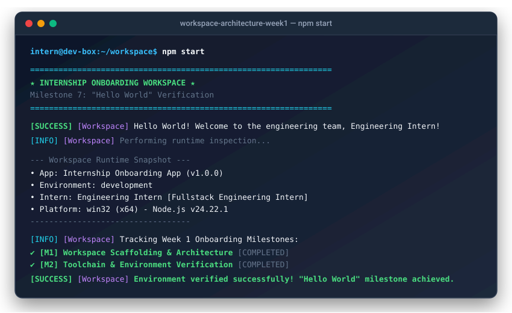

# 🚀 Internship Onboarding Workspace

[](https://nodejs.org/)
[](LICENSE)
[](#)
[](#)

Welcome to the engineering team! This repository represents your **standardized, production-grade onboarding workspace**. It is designed to take you from a fresh clone to an active, validated development state with zero friction.

---

## 🖥️ Workspace Preview

<p align="center">
  
</p>

<details open>
<summary><b>🔍 Click to view verified Terminal Execution Output (<code>npm start</code>)</b></summary>

```bash
$ npm start

================================================================
  ★ INTERNSHIP ONBOARDING WORKSPACE ★
    Milestone 7: "Hello World" Verification
================================================================
[SUCCESS] [Workspace] Hello World! Welcome to the engineering team, Engineering Intern!
[INFO]    [Workspace] Performing runtime inspection...

--- Workspace Runtime Snapshot ---
• App:         Internship Onboarding App (v1.0.0)
• Environment: development
• Intern:      Engineering Intern [Fullstack Engineering Intern]
• Mentor:      Senior Mentor
• Platform:    win32 (x64) - Node.js v24.22.1
• Memory:      3.43 GB free of 15.71 GB
----------------------------------

[INFO]    [Workspace] Tracking Week 1 Onboarding Milestones:
  ✔ [M1] Workspace Scaffolding & Architecture       [COMPLETED]
  ✔ [M2] Toolchain & Environment Verification       [COMPLETED]
  ✔ [M3] Version Control & Git Conventions          [COMPLETED]
  ▶ [M4] Hello World Execution Milestone            [IN_PROGRESS]
  ○ [M5] First Pull Request & Code Review           [PENDING]

[SUCCESS] [Workspace] Environment verified successfully! "Hello World" milestone achieved.
```

</details>

<details>
<summary><b>🩺 Click to view Automated Health Check Diagnostic Output (<code>npm run healthcheck</code>)</b></summary>

```bash
$ npm run healthcheck

================================================================
   INTERNSHIP ONBOARDING WORKSPACE - ENVIRONMENT HEALTH CHECK   
================================================================

  [PASS] Node.js Runtime                     : v24.22.1 (Supported >= v18)
  [PASS] npm Package Manager                 : v11.19.1
  [PASS] Git Version Control CLI             : git version 2.56.0.windows.2
  [PASS] Git Repository Init                 : Workspace is an active Git repository
  [PASS] Git User Identity                   : Snigdhendu-Chhotaray-28 <snigdhenduchhotaray@gmail.com>
  [PASS] Python Runtime (Secondary)          : Python 3.15.1
  [PASS] Workspace Directory Layout          : All 9 architectural directories verified
  [PASS] Critical Files & Docs               : All configurations, templates & docs present

Diagnostics Summary:
  Passed: 8 | Warnings: 0 | Failures: 0

✔ WORKSPACE HEALTH CHECK PASSED: System ready for engineering sprint!
```

</details>

---

## 🌟 Quick Start Guide

Get up and running in less than 2 minutes:

### Option A: Automated Bootstrapper (Recommended)
On **Windows (PowerShell)**:
```powershell
npm run setup:win
```

On **macOS / Linux / WSL (Bash)**:
```bash
npm run setup:unix
```

### Option B: Manual Setup Steps
1. **Initialize Local Environment**:
   ```bash
   cp .env.example .env    # On Windows: Copy-Item .env.example .env
   ```
2. **Run System Health Diagnostics**:
   ```bash
   npm run healthcheck
   ```
3. **Execute Test Suite**:
   ```bash
   npm test
   ```
4. **Launch "Hello World" Application**:
   ```bash
   npm start
   ```

---

## 🧭 Repository Navigation & Directory Layout

| Directory / File | Description |
| :--- | :--- |
| [`src/`](file:///src/) | Application source code (`src/index.js`, `src/core/`, `src/utils/`) |
| [`tests/`](file:///tests/) | Native zero-dependency unit and smoke test suites |
| [`config/`](file:///config/) | Environment variable loader and default configuration settings |
| [`scripts/`](file:///scripts/) | Cross-platform setup, automation, and diagnostic health check scripts |
| [`docs/`](file:///docs/) | Central documentation hub and engineering knowledge base |
| [`docs/fundamentals/`](file:///docs/fundamentals/) | In-depth engineering modules (Clean Code, Git, Modern Web) |
| [`.vscode/`](file:///.vscode/) | Workspace settings, recommended extensions, and debug launch profiles |
| [`.github/`](file:///.github/) | CI/CD pipelines (`ci.yml`) and pull request templates |
| [`ONBOARDING_CHECKLIST.md`](file:///ONBOARDING_CHECKLIST.md) | Interactive daily progression checklist for interns and mentors |
| [`CONTRIBUTING.md`](file:///CONTRIBUTING.md) | Branch naming rules, Conventional Commits, and code review standards |

---

## 🎯 Onboarding Milestones Tracker

| Milestone | Objective | Status | Verification Command |
| :---: | :--- | :---: | :--- |
| **M1** | **Workspace Orientation & Scaffolding** | ✅ Verified | Inspect folder tree |
| **M2** | **Toolchain & Automated Setup** | ✅ Verified | `npm run healthcheck` |
| **M3** | **Development Environment & VS Code Config** | ✅ Verified | `.vscode/settings.json` |
| **M4** | **Clean Architecture & Separation of Concerns** | ✅ Verified | `docs/ARCHITECTURE.md` |
| **M5** | **Role-Specific Core Fundamentals** | ✅ Verified | `docs/fundamentals/` |
| **M6** | **Git, GitHub & Version Control Protocols** | ✅ Verified | `CONTRIBUTING.md` |
| **M7** | **"Hello World" Execution Milestone** | ✅ Verified | `npm start` |
| **M8** | **Team Workflow & Standup Protocols** | ✅ Verified | `docs/WORKFLOW.md` |
| **M9** | **Curated Resource Hub & Cheatsheet** | ✅ Verified | `docs/RESOURCES.md` |
| **M10**| **Interactive Onboarding Tracker** | ✅ Verified | `ONBOARDING_CHECKLIST.md`|
| **M11**| **Automated End-to-End Health Check** | ✅ Verified | `npm run healthcheck` |

---

## 🛠 Available Lifecycle Scripts

- `npm start`: Runs the modular "Hello World" application entrypoint (`src/index.js`).
- `npm test`: Runs the full unit and smoke test suites via Node's native test runner.
- `npm run test:watch`: Runs tests in live watch mode upon file modification.
- `npm run healthcheck`: Runs the automated environment diagnostic script.
- `npm run setup:win`: Runs the automated PowerShell installer on Windows.
- `npm run setup:unix`: Runs the automated Bash installer on macOS/Linux.

---

## 🤝 Need Help?

- Check out [`docs/WORKFLOW.md`](file:///docs/WORKFLOW.md) for the **15-Minute Unblocking Rule**.
- Review the [`docs/CHEATSHEET.md`](file:///docs/CHEATSHEET.md) for quick terminal command references.
- Ping your mentor or post in `#dev-help-desk` with the 4-point question format.
