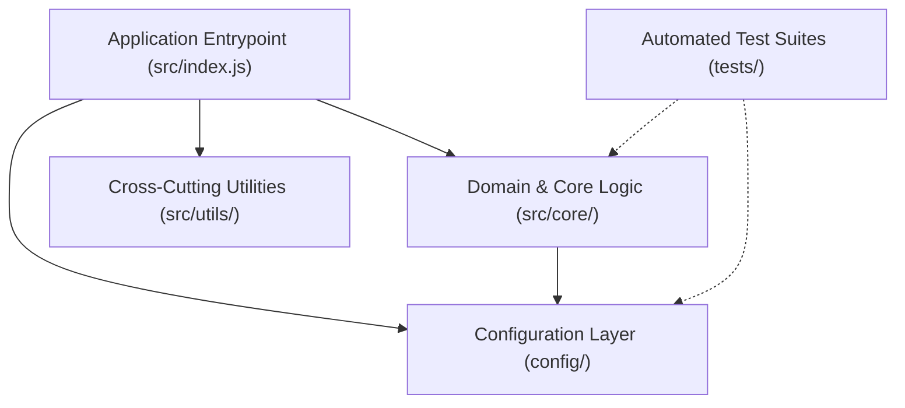

# System Architecture & Engineering Conventions

This document outlines the architectural philosophy, folder structures, design patterns, and naming conventions implemented in this workspace.

---

## 1. Architectural Philosophy: Layered Separation of Concerns

The codebase is organized into distinct, isolated layers where each layer has a single, well-defined responsibility:



### Layer Descriptions:
1. **Entrypoint (`src/index.js`)**: Orchestrates initialization, dependency wiring, execution lifecycles, and exit status handling. It contains minimal logic.
2. **Core Domain (`src/core/`)**: Pure business logic, computations, and domain services. Functions in this layer should be deterministic and easily testable without mocks.
3. **Utilities (`src/utils/`)**: Reusable helper functions, formatting tools, loggers, and system adapters.
4. **Configuration (`config/`)**: Environment validation, default fallbacks, and immutable application-wide settings.
5. **Testing (`tests/`)**: Mirrors the code structure to provide comprehensive unit and integration verification.

---

## 2. Directory Tree Structure

```
workspace-architecture-week1/
├── .github/                       # CI/CD pipelines & GitHub templates
│   ├── workflows/ci.yml           # Multi-platform automated CI matrix
│   └── pull_request_template.md   # Standardized PR template
├── .vscode/                       # IDE workspace configurations
│   ├── extensions.json            # Recommended extensions
│   ├── launch.json                # Pre-configured debug profiles
│   └── settings.json              # Lint-on-save & formatting rules
├── config/                        # Configuration layer
│   ├── default.json               # Default settings & metadata
│   └── environment.js             # Environment loader (.env reader)
├── docs/                          # Engineering documentation
│   ├── fundamentals/              # Core engineering learning tracks
│   │   ├── clean-code-and-conventions.md
│   │   ├── git-and-github-best-practices.md
│   │   └── modern-software-engineering.md
│   ├── ARCHITECTURE.md            # System architecture (this file)
│   ├── CHEATSHEET.md              # CLI & developer cheat sheet
│   ├── RESOURCES.md               # Curated external resources & guides
│   └── WORKFLOW.md                # Communication & team rituals
├── scripts/                       # DevOps & automated toolchains
│   ├── health-check.js            # Node cross-platform health checker
│   ├── health-check.ps1           # Windows PowerShell health checker
│   ├── health-check.sh            # Unix Bash health checker
│   ├── setup.ps1                  # Windows automated bootstrapper
│   └── setup.sh                   # Unix automated bootstrapper
├── src/                           # Application source code
│   ├── core/                      # Pure business logic
│   │   └── greeting.js            # Greeting & system inspection service
│   ├── utils/                     # Shared cross-cutting helpers
│   │   └── logger.js              # ANSI-colored structured logger
│   └── index.js                   # Main application entrypoint
├── tests/                         # Test suites
│   ├── greeting.test.js           # Core module unit tests
│   └── smoke.test.js              # Application smoke tests
├── .env.example                   # Environment configuration template
├── .gitignore                     # Multi-environment ignore file
├── CONTRIBUTING.md                 # Contribution & Git standards
├── ONBOARDING_CHECKLIST.md        # Interactive progress tracker
├── package.json                   # Project manifest & lifecycle scripts
└── README.md                      # Primary onboarding welcome portal
```

---

## 3. Naming Conventions

Consistency across naming eliminates cognitive load and enhances code readability:

| Entity | Convention | Example |
| :--- | :--- | :--- |
| **Files & Folders** | `kebab-case` or `lower_snake` | `greeting.test.js`, `health-check.js`, `clean-code-and-conventions.md` |
| **Variables & Functions** | `camelCase` | `buildWelcomeMessage()`, `getSystemInspection()`, `totalMemory` |
| **Classes** | `PascalCase` | `Logger`, `ConfigService` |
| **Constants & Enums** | `UPPER_SNAKE_CASE` | `ONBOARDING_MILESTONES`, `LOG_LEVELS`, `PORT` |
| **Environment Variables** | `UPPER_SNAKE_CASE` | `NODE_ENV`, `APP_NAME`, `PORT` |

---

## 4. Key Design Patterns

- **Dependency Inversion / Purity**: Functions accept their dependencies and options rather than relying on global mutable state.
- **Fail-Fast Configuration**: Critical environment variables are parsed and validated at initialization time rather than deep in runtime execution.
- **Single Source of Truth**: All configurations originate from `config/environment.js`.
- **Zero-Dependency Core**: The initial onboarding framework utilizes Node.js native standard libraries (`node:test`, `node:assert`, `node:fs`, `node:os`) to ensure instant zero-install verification across all developer environments.
