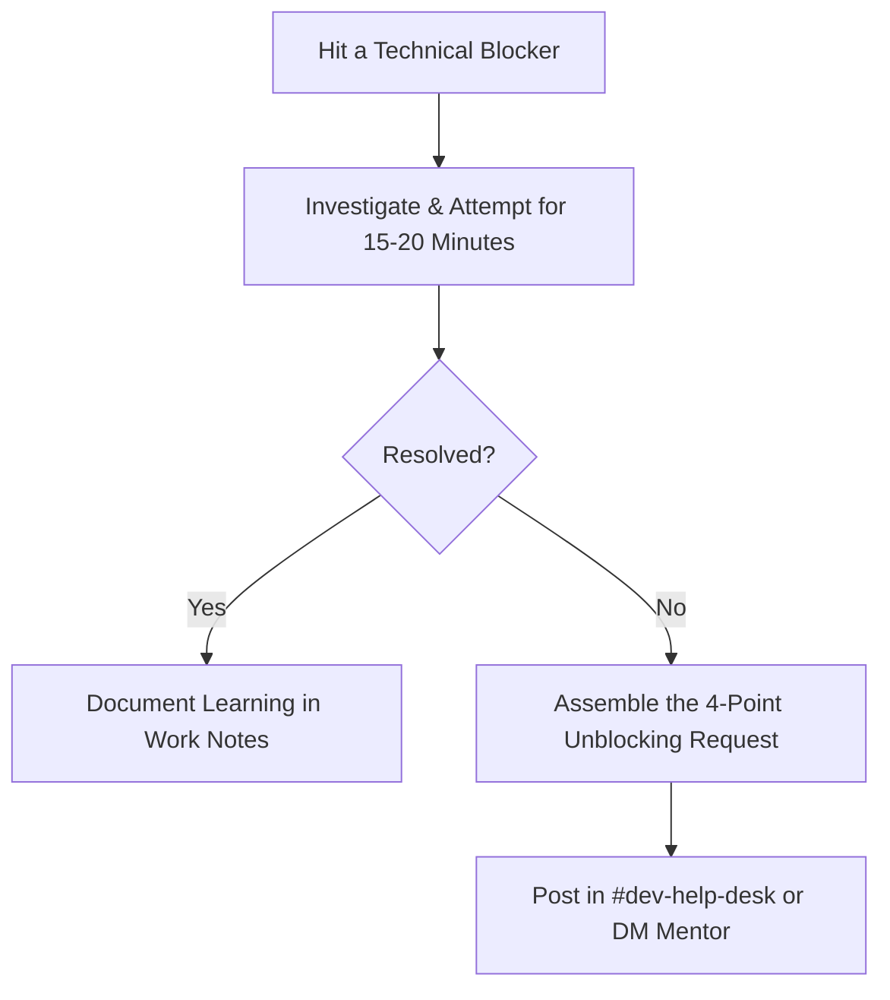

# Team Workflow, Protocols & Communication Standards

Software engineering is fundamentally a collaborative discipline. This document outlines our team rituals, communication guidelines, and escalation protocols to ensure you feel supported, unblocked, and empowered throughout your internship.

---

## 1. Communication Channels & Etiquette

| Channel | Platform | Purpose | Expected Response SLA |
| :--- | :--- | :--- | :--- |
| **#engineering-team** | Slack / Teams | General dev discussions, announcements, wins | Within 2 hours during work hours |
| **#dev-help-desk** | Slack / Teams | Technical questions, toolchain issues, environment setup | Within 30 minutes |
| **#standup-async** | Slack / Teams | Daily async standup updates | Before 10:00 AM local time |
| **Pull Requests** | GitHub | Formal code review, architectural critique | Within 24 business hours |
| **Direct Message / Huddle** | Slack / Meet | Time-sensitive blockers or 1-on-1 mentorship | Immediate / Scheduled |

---

## 2. Daily Standup Ritual

Every morning by 10:00 AM, post your daily standup in `#standup-async` using the **3-Bullet Format**:

```markdown
**Daily Standup - [Your Name] - [Date]**
1. **Yesterday**: Completed M3 Git setup and created `.github/pull_request_template.md`.
2. **Today**: Implementing M4 "Hello World" verification script and writing unit tests.
3. **Blockers**: None currently (or: "Need review on PR #4 to proceed with database migration").
```

---

## 3. The "15-Minute Rule" for Unblocking Yourself

Getting stuck is a natural part of engineering. To optimize both your learning and your mentor's time, practice the **15-Minute Rule**:



### The 4-Point Unblocking Request Template:
When reaching out for help, always formulate your message with these four elements:
1. **Goal**: What are you trying to accomplish?
2. **Observation**: What actually happened? (Include exact error messages, stack traces, or screenshots)
3. **Hypothesis**: What do you think the issue might be?
4. **Attempts**: What solutions or commands have you already tried?

*Example:*
> *"Hey @mentor, I'm trying to run `npm test` on Windows (Goal). It fails with `Error: Cannot find module '../src/index.js'` (Observation). I suspect it's related to ES module path resolution or relative paths in tests (Hypothesis). I tried switching between relative paths and fileURLToPath, but still hit the same error (Attempts). Could you take a look when free?"*

---

## 4. Code Review Etiquette

### Submitting a Review Request:
- Keep PRs small (< 300 lines of code change where possible).
- Self-review your diff on GitHub before requesting others.
- Ensure all CI tests pass and provide a brief walkthrough in the PR description.

### Receiving Feedback:
- Feedback is directed at the **code**, not at you as an individual.
- Respond to every comment: explain your rationale, or commit the suggested improvement and mark the thread resolved.
- If a discussion spans more than 4 back-and-forth comments, schedule a quick 5-minute huddle to align directly.

---

## 5. Escalation & Support Pathways

If an issue is blocking your progress and your assigned mentor is unavailable:
1. Ping the secondary mentor listed in your `.env` configuration.
2. Tag `@engineering-leads` in `#dev-help-desk`.
3. Switch temporarily to an asynchronous learning track in `docs/fundamentals/` while waiting for resolution.
